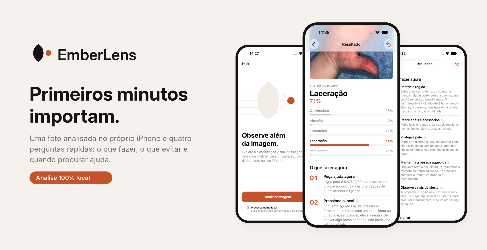
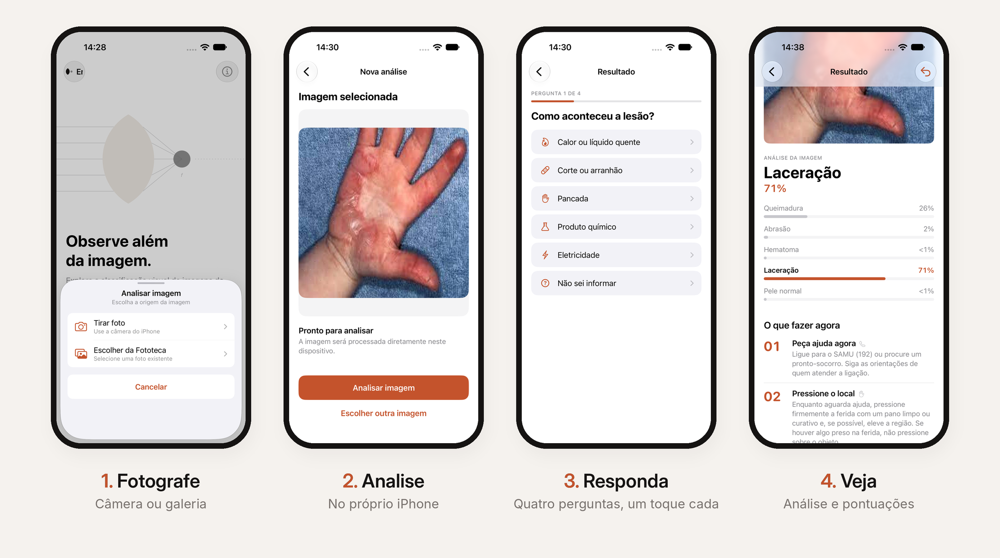
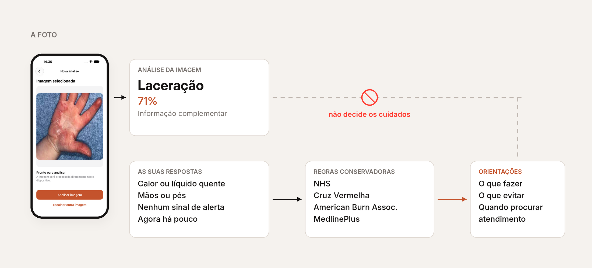
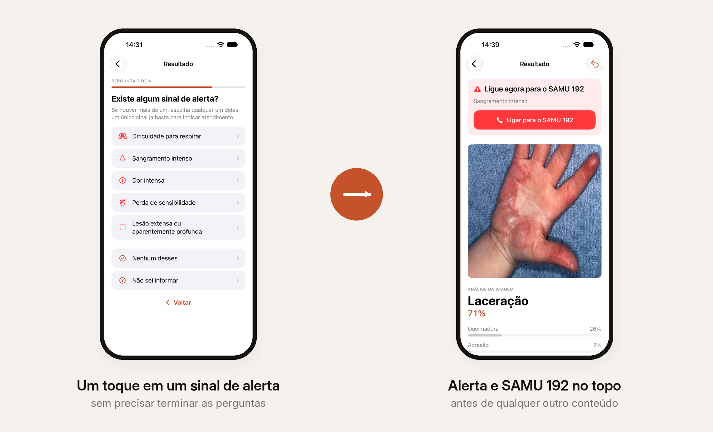

<p align="center">
  
</p>

<p align="center">
  <strong>EmberLens</strong> ajuda a não errar nos primeiros minutos depois de uma lesão de pele.<br>
  App iOS em SwiftUI que analisa a foto no próprio iPhone e, a partir de quatro perguntas, mostra o que fazer, o que evitar e quando procurar ajuda.
</p>

<br>

## O problema

Queimadura na cozinha, corte no trabalho, pancada em casa: quase nunca há um
profissional de saúde por perto quando acontece. Nos primeiros minutos, quem
está ali decide sozinho, e é comum decidir pelo improviso: manteiga, pasta de
dente, gelo direto na pele, bolha estourada. As orientações de primeiros
socorros de referência, como as do NHS e da Cruz Vermelha, pedem justamente o
contrário.

A segunda dúvida pesa tanto quanto a primeira: **isso é caso de procurar
atendimento?** Sem orientação, há quem corra para o pronto-socorro sem
necessidade e quem espere demais numa situação que pedia ajuda imediata.

E a resposta fácil, um app que "diagnostica pela foto", é perigosa. Uma foto não
mostra a profundidade de uma queimadura, não sabe se foi um produto químico e
não percebe que a pessoa está com dificuldade para respirar.

## O que ele faz

<p align="center">
  
</p>

Você fotografa a lesão ou escolhe uma foto da galeria. O modelo analisa a imagem
ali mesmo, sem internet, e o app faz quatro perguntas de um toque: como
aconteceu, onde está, se há algum sinal de alerta e quando foi. Pronto, a tela
de resultado responde ao que importa naquele momento:

- **Com o que a foto se parece?** A categoria visual mais próxima e as pontuações das cinco categorias, em barras.
- **O que eu faço agora?** Passos curtos e numerados, como resfriar a região por 20 minutos com água corrente.
- **O que eu não devo fazer?** Uma lista curta: gelo direto na pele, receitas caseiras, estourar bolhas.
- **Preciso de atendimento?** Os sinais que pedem um serviço de saúde, sempre visíveis, com o botão do SAMU 192.

As orientações mudam com as respostas. Uma queimadura de agora começa pelo
resfriamento; a mesma queimadura de alguns dias atrás não, porque resfriar só
ajuda nas primeiras horas. Um corte começa por estancar o sangramento, uma
pancada pelo frio protegido.

## A foto não decide os cuidados

<p align="center">
  
</p>

Uma classificação errada não pode virar um cuidado errado. Por isso a análise da
imagem e as orientações são caminhos separados: a regra que monta as
orientações recebe só as respostas do usuário. O resultado do modelo não é nem
um parâmetro dela.

Cada orientação é um texto fixo, escrito a partir de fontes que qualquer pessoa
pode conferir, e não é gerado por IA. Na dúvida, o app escolhe a cautela: "não
sei informar" nunca é lido como "está tudo bem", e sem saber a causa da lesão
ele não arrisca cuidados específicos. As regras e as fontes de cada frase estão
em [`docs/guidance-sources.md`](docs/guidance-sources.md).

## Emergência em primeiro lugar

<p align="center">
  
</p>

Dificuldade para respirar, sangramento intenso, choque elétrico, produto
químico: basta um toque em qualquer sinal de alerta para o questionário parar.
O alerta e o botão de ligar para o SAMU 192 vão para o topo da tela, antes da
foto e de qualquer outra informação. Não é preciso terminar as perguntas para
ser orientado a buscar ajuda.

## Onde pode ser aplicado

O EmberLens é um protótipo, mas o desenho dele aponta para usos reais, desde
que acompanhados de validação clínica:

- **Educação em primeiros socorros**, em escolas, empresas e treinamentos de brigada, para ensinar o que fazer e, principalmente, o que não fazer.
- **Lugares com pouca conectividade**, porque tudo roda no aparelho: zona rural, estrada, rede fora do ar.
- **Pré-atendimento em telessaúde**, organizando a foto e as respostas antes da consulta para o profissional chegar com mais contexto.
- **Referência de IA responsável em saúde**, mostrando como usar um modelo de visão sem transformá-lo em diagnóstico.

## Por dentro

| | |
| --- | --- |
| **App** | SwiftUI, Observation (`@Observable`), arquitetura MVVM, injeção de dependências por protocolos e estados explícitos da análise |
| **Modelo** | MobileNetV3 Small treinada em PyTorch por transfer learning e convertida para Core ML (3 MB), executada com Vision no próprio iPhone |
| **Dados** | Cerca de 1.100 fotos distintas do dataset público [Basic Wound Classify](https://universe.roboflow.com/mahrukh-qmtw8/basic-wound-classify-mpoys-rlpoq/dataset/1), com duplicatas agrupadas para que nenhuma foto de teste tivesse cópia no treino. Acerto de 84% num teste avaliado uma única vez |
| **Orientações** | Regras puras e determinísticas, cobertas por testes com Swift Testing que percorrem as 1.008 combinações de respostas e conferem fontes e termos proibidos |
| **Acessibilidade** | Dynamic Type, Dark Mode, VoiceOver com rótulos e áreas de toque amplas |

O repositório tem as partes lado a lado: `ios/` é o app, `ml/` é o treino e a
conversão do modelo, e `design/` é a identidade visual. Os detalhes técnicos
estão em [metodologia](docs/methodology.md), [avaliação do modelo](docs/model-evaluation.md)
e [conversão para Core ML](docs/coreml-conversion.md).

## Rodando

<details>
<summary>Ver os passos</summary>

<br>

Você precisa de um Mac com o Xcode recente e do Git LFS, que baixa o modelo.

```bash
git clone https://github.com/Peregrinoo/Emberleans.git
cd Emberleans
git lfs pull
open ios/emberleans/emberleans.xcodeproj
```

Escolha um simulador de iPhone e rode com ⌘R. O treino e a avaliação do modelo
estão em [`ml/README.md`](ml/README.md).

</details>

## Limites e próximos passos

O EmberLens não é um dispositivo médico e não faz diagnósticos. O dataset é
pequeno e vem da web, o modelo ainda erra com frequência e o desempenho em fotos
reais de iPhone não foi medido. Em uma emergência, ligue 192.

- Ampliar o dataset com fotos distintas e avaliar com um conjunto externo.
- Revisar as orientações com profissionais de saúde e material do Ministério da Saúde.
- Medir o desempenho do modelo em fotos tiradas com a câmera do iPhone.
- Abrir as fontes de cada orientação direto na tela, com um toque.

<br>

<p align="center">
  Feito por <a href="https://chaaves.xyz">Gabriel Chaves</a>, estudante de Engenharia de Telecomunicações no IFCE.<br>
  <sub>Fotos de exemplo do dataset Basic Wound Classify (Roboflow Universe, CC BY 4.0).</sub>
</p>
