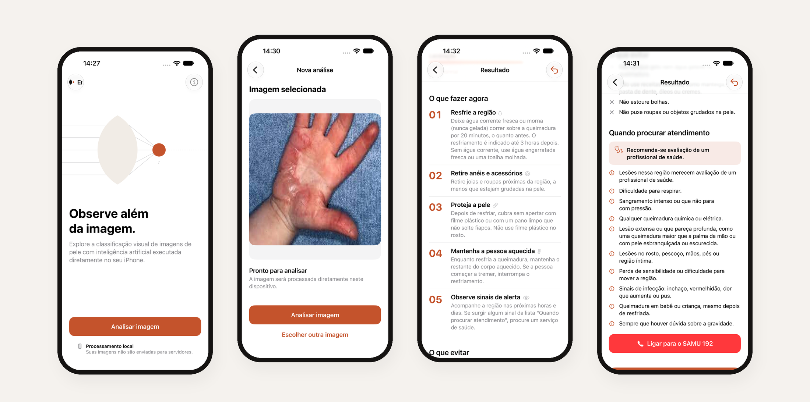
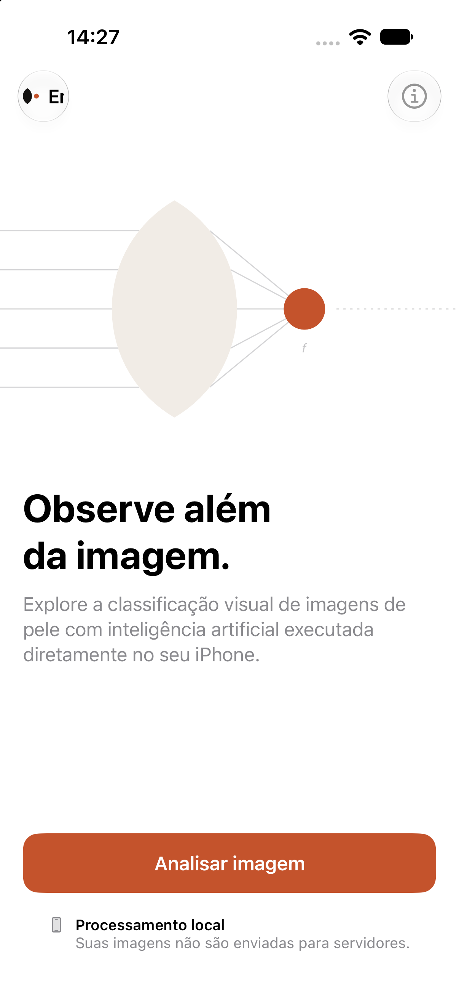
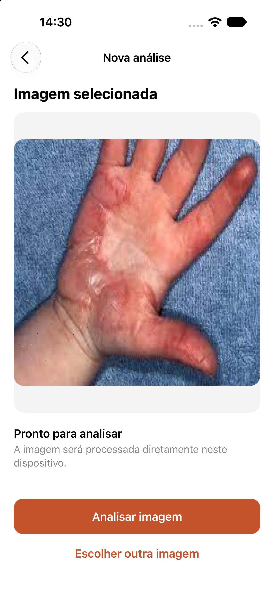
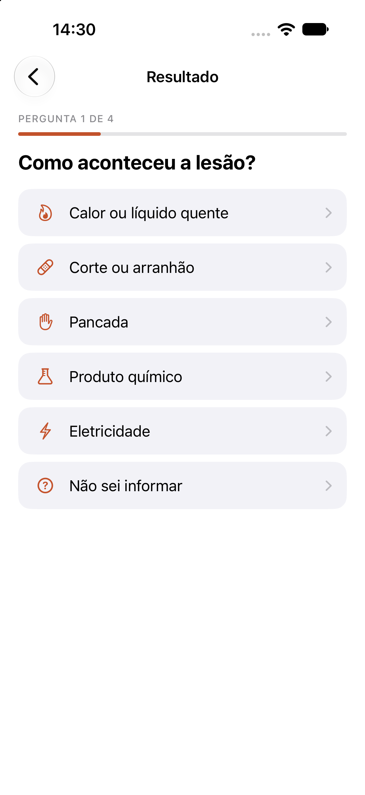
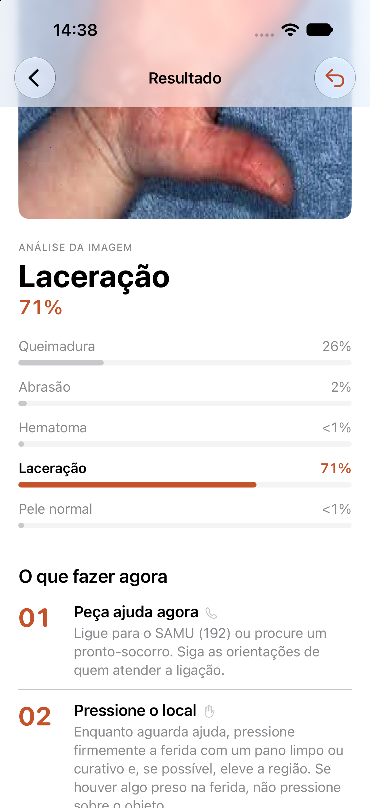
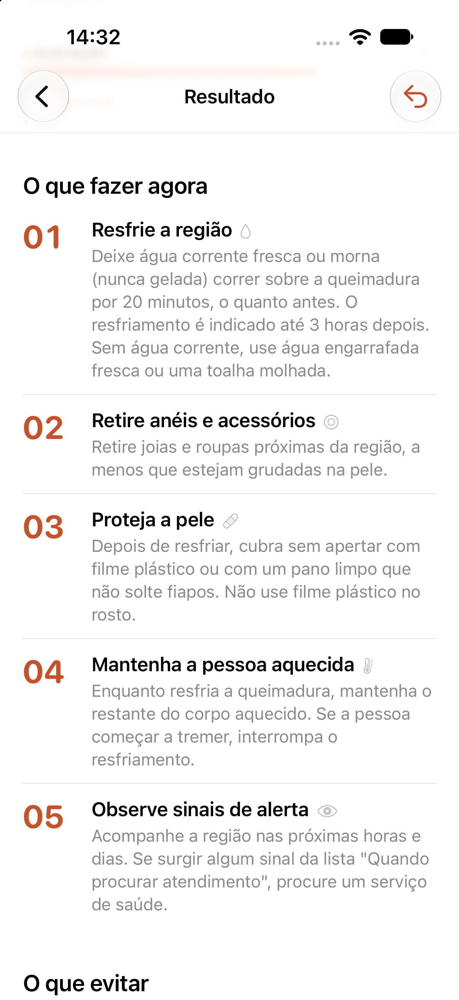
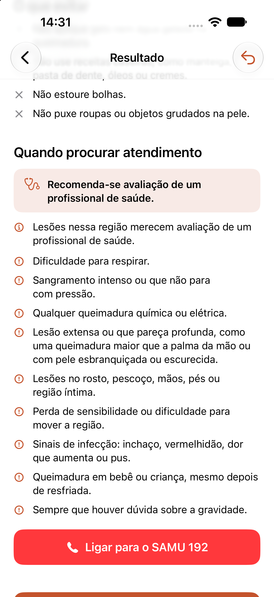
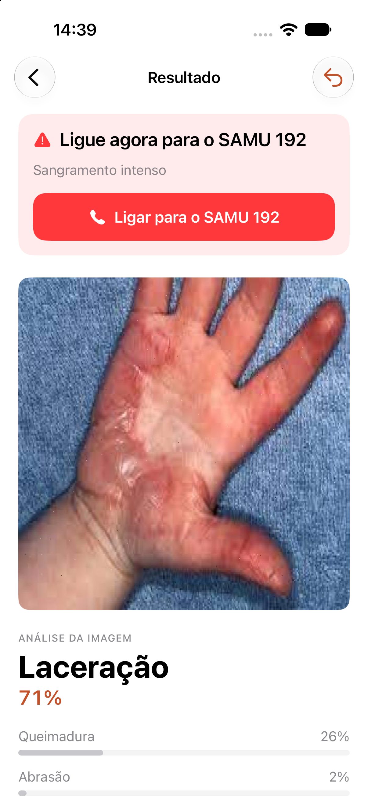

<div align="center">

<picture>
  <source media="(prefers-color-scheme: dark)" srcset="design/branding/logo/emberlens-logo-horizontal-negative.svg">
  
</picture>

### Primeiros minutos importam. O EmberLens ajuda a não errar neles.

Um app para iPhone que analisa a foto de uma lesão de pele no próprio aparelho e,<br>
a partir de quatro perguntas rápidas, mostra o que fazer, o que evitar e quando procurar ajuda.




</div>

> [!WARNING]
> **O EmberLens não é um dispositivo médico e não faz diagnósticos.** É um projeto experimental e de portfólio. Em
> uma emergência, ligue **192 (SAMU)**.

## O problema

Queimaduras, cortes e pancadas acontecem em casa, na cozinha, no trabalho, e quase nunca perto de um profissional de
saúde. Nos primeiros minutos, quem está ali precisa decidir sozinho, e as decisões mais comuns costumam vir do
improviso: passar manteiga ou pasta de dente, pôr gelo direto na pele, estourar bolhas. As principais orientações de
primeiros socorros, como as do NHS e da Cruz Vermelha, recomendam justamente evitar essas práticas.

Há uma segunda dúvida, tão importante quanto a primeira: **isso é caso de procurar atendimento?** Sem orientação,
algumas pessoas vão ao pronto-socorro sem necessidade, e outras demoram em situações que pedem ajuda imediata.

Aplicativos de "diagnóstico por foto" parecem uma solução óbvia, mas são perigosos: uma foto não mostra a
profundidade de uma queimadura, não sabe se foi um produto químico e não percebe que a pessoa está com dificuldade
para respirar.

## A proposta

O EmberLens separa duas coisas que costumam ser misturadas:

| | **Análise da imagem** | **Orientações** |
|---|---|---|
| vem de | um modelo de visão computacional | quatro perguntas respondidas pelo usuário |
| mostra | com qual categoria visual a foto mais se parece | o que fazer, o que evitar e quando procurar atendimento |
| decide os cuidados? | **não** | sim, com regras conservadoras e fontes citadas |

Assim a tecnologia contribui com o que faz bem, que é reconhecer padrões visuais, sem ser usada para decidir o que
ela não consegue avaliar.

- **Emergência em primeiro lugar.** Qualquer sinal de alerta, como sangramento intenso ou choque elétrico, interrompe
  as perguntas e mostra na hora o botão para ligar para o SAMU 192.
- **Na dúvida, mais cautela.** "Não sei informar" nunca é tratado como "está tudo bem".
- **Nada inventado.** As orientações são textos fixos, sem IA generativa, baseados em NHS, Cruz Vermelha Britânica,
  American Burn Association e MedlinePlus ([`docs/guidance-sources.md`](docs/guidance-sources.md)).
- **Privacidade total.** A foto é analisada no próprio iPhone, nunca sai do aparelho, e o app funciona sem internet.

## Como funciona

<table>
  <tr>
    <td align="center" width="25%"></td>
    <td align="center" width="25%"></td>
    <td align="center" width="25%"></td>
    <td align="center" width="25%"></td>
  </tr>
  <tr>
    <td align="center"><b>1. Fotografe</b><br><sub>Câmera ou galeria</sub></td>
    <td align="center"><b>2. Analise</b><br><sub>No próprio iPhone</sub></td>
    <td align="center"><b>3. Responda</b><br><sub>4 perguntas, um toque cada</sub></td>
    <td align="center"><b>4. Veja</b><br><sub>Análise e pontuações</sub></td>
  </tr>
</table>

<table>
  <tr>
    <td align="center" width="33%"></td>
    <td align="center" width="33%"></td>
    <td align="center" width="33%"></td>
  </tr>
  <tr>
    <td align="center"><b>O que fazer agora</b><br><sub>Passos curtos e numerados</sub></td>
    <td align="center"><b>Quando procurar atendimento</b><br><sub>Sinais de alerta sempre visíveis</sub></td>
    <td align="center"><b>Emergência</b><br><sub>Alerta e SAMU 192 antes de tudo</sub></td>
  </tr>
</table>

## Onde isso pode ser aplicado

O EmberLens é um protótipo, mas o desenho dele aponta para usos reais, **desde que acompanhados de validação clínica**:

- **Educação em primeiros socorros.** Uma ferramenta de apoio em escolas, empresas e treinamentos de brigada, para
  ensinar o que fazer e, principalmente, o que não fazer.
- **Locais com pouca conectividade.** Como tudo roda no aparelho, a orientação funciona em zonas rurais, em
  deslocamento ou quando a rede cai.
- **Pré-atendimento em telessaúde.** Como etapa de organização antes de uma consulta: a pessoa registra a foto e as
  respostas, e o profissional recebe um contexto melhor.
- **Referência de IA responsável em saúde.** Um exemplo de como colocar um modelo de visão num produto sem
  transformá-lo em diagnóstico: separar o que o modelo vê do que se recomenda, tratar emergências primeiro e citar
  fontes.

## Design

Identidade visual própria: o símbolo é uma lente focal, a cor de destaque é o laranja Ember, a tipografia é SF Pro e
todos os componentes são nativos do iOS. O app suporta modo escuro, Dynamic Type e VoiceOver.

<table>
  <tr>
    <td align="center" width="33%"></td>
    <td align="center" width="33%"></td>
    <td align="center" width="33%"></td>
  </tr>
</table>

O guia de marca e o design system estão em [`design/`](design/README.md).

## Por baixo do capô

Em resumo:

- **Modelo:** uma MobileNetV3 Small, rede leve pensada para celulares, treinada em PyTorch com transfer learning para
  reconhecer cinco categorias: queimadura, abrasão, hematoma, laceração e pele normal.
- **Dados:** cerca de 1.100 fotos distintas do dataset público
  [Basic Wound Classify](https://universe.roboflow.com/mahrukh-qmtw8/basic-wound-classify-mpoys-rlpoq/dataset/1).
  Duplicatas foram agrupadas e o conjunto foi redividido para que nenhuma foto de teste tivesse uma cópia no treino.
- **Resultado:** **84% de acerto** num conjunto de teste avaliado uma única vez. É um número honesto para um dataset
  pequeno, mas longe de uso clínico.
- **No iPhone:** o modelo foi convertido para Core ML (3 MB) e roda com Vision. O app é SwiftUI com MVVM, e as regras
  de orientação são funções puras cobertas por testes, incluindo a verificação das 1.008 combinações de respostas.

Para quem quiser os detalhes: [metodologia](docs/methodology.md) · [avaliação do modelo](docs/model-evaluation.md) ·
[conversão para Core ML](docs/coreml-conversion.md) · [pipeline de ML](ml/README.md)

## Como rodar

Requer um Mac com Xcode 27 ou superior; o app roda em iOS 17+.

```bash
git clone https://github.com/Peregrinoo/Emberleans.git && cd Emberleans
git lfs pull                       # baixa o modelo Core ML
open ios/emberleans/emberleans.xcodeproj
```

Escolha um simulador de iPhone e pressione ⌘R.

## Limitações

- O dataset é pequeno e vem da web, e o modelo ainda erra com frequência, principalmente em queimaduras graves.
- O desempenho em fotos reais tiradas com iPhone não foi medido.
- As orientações seguem fontes internacionais e precisariam de revisão por profissionais de saúde e com material do
  Ministério da Saúde antes de qualquer uso real.

## Licença e créditos

Código e documentação sob [MIT](LICENSE). O dataset *Basic Wound Classify*, de Mahrukh (Roboflow Universe), é
licenciado sob CC BY 4.0 e não é redistribuído aqui.

Desenvolvido por [Gabriel Chaves](https://chaaves.xyz).
