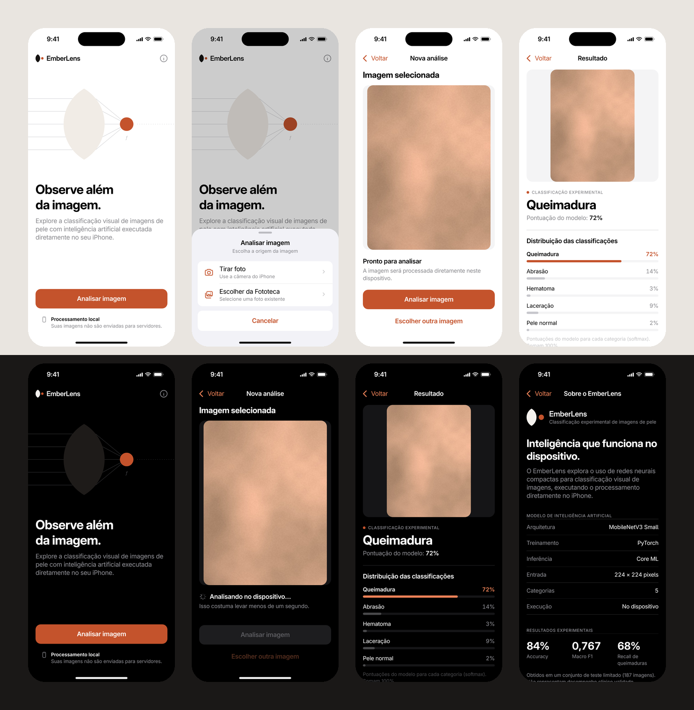

# EmberLens · Design

Identidade visual e design de interface do EmberLens para iOS. Esta etapa cobre marca, componentes e telas. O app
SwiftUI ainda não foi implementado.



## Direção

* **Símbolo "Ponto focal":** uma lente biconvexa (a interseção de dois círculos) e o ponto onde a luz converge.
  Concentrar luz numa lente é o jeito literal de acender uma brasa: *Ember + Lens* em dois sólidos geométricos.
* **Cor:** neutros do sistema iOS e um único acento, **Ember `#C4532C`**, refinado a partir de `#D96B45` para
  atingir contraste AA com texto branco. No Dark Mode, textos e destaques usam **Ember 300 `#EC8157`**.
* **Tipografia:** fonte do sistema (SF Pro) com estilos semânticos e Dynamic Type. Inter Display entra apenas no
  logotipo, convertido em curvas.
* **Composição:** fotografia como protagonista, tipografia editorial alinhada à esquerda, divisórias finas no lugar
  de cartões, componentes nativos e nenhuma estética de IA ou hospitalar.

## Conteúdo

```
design/
├── README.md
├── branding/
│   ├── logo/                 15 SVGs (símbolo, horizontal, vertical × color, negative, mono-black, mono-white, accent)
│   │   ├── logo-final.png    construção e variantes
│   │   └── concepts/         3 conceitos (SVG) + prancha comparativa
│   ├── app-icon/
│   │   ├── AppIcon.appiconset/   Light (RGB sem alfa), Dark e Tinted 1024 px + Contents.json
│   │   ├── svg/              fontes vetoriais do ícone
│   │   ├── layers/           camadas para o Icon Composer (iOS 26)
│   │   └── preview-sizes.png
│   ├── colors/               paleta, tokens.json, EmberLensColors.xcassets
│   └── typography/           escala tipográfica
├── screens/                  PNG @3x (1179 × 2556), Light e Dark
│   ├── home/                 Home
│   ├── image-selection/      sheet de origem + permissão negada, câmera indisponível, erro de captura, falha na Fototeca
│   ├── preview/              pronto, processando, erro de carregamento
│   ├── result/               rolagem completa, viewport, erro de inferência
│   └── about/                rolagem completa e viewport
├── components/               folhas de componentes (Light e Dark)
├── documentation/
│   ├── brand-guidelines.md   conceito, construção, uso do logo, App Icon
│   ├── design-system.md      tokens, tipografia, espaçamento, componentes, movimento, acessibilidade
│   ├── swiftui-handoff.md    especificação por tela, estados, textos, assets
│   └── navigation-flow.svg/png
└── source/                   scripts que geram todos os artefatos (fonte editável)
```

## Telas

| | Light | Dark |
|---|---|---|
| Home | [home-light](screens/home/home-light.png) | [home-dark](screens/home/home-dark.png) |
| Origem da imagem | [source-sheet-light](screens/image-selection/source-sheet-light.png) | [source-sheet-dark](screens/image-selection/source-sheet-dark.png) |
| Prévia | [preview-ready-light](screens/preview/preview-ready-light.png) | [preview-ready-dark](screens/preview/preview-ready-dark.png) |
| Processando | [preview-processing-light](screens/preview/preview-processing-light.png) | [preview-processing-dark](screens/preview/preview-processing-dark.png) |
| Resultado | [result-full-light](screens/result/result-full-light.png) | [result-full-dark](screens/result/result-full-dark.png) |
| Sobre | [about-full-light](screens/about/about-full-light.png) | [about-full-dark](screens/about/about-full-dark.png) |
| Erros e permissões | [image-selection/](screens/image-selection/), [preview-load-error](screens/preview/preview-load-error-light.png), [result-inference-error](screens/result/result-inference-error-light.png) | variantes `-dark` |

## Observações importantes

* **Fotografia ilustrativa:** textura de pele gerada por código, sem lesão. Nenhuma foto médica ou do dataset foi
  usada.
* **Valores de exemplo:** as pontuações (72%…) e o tempo de inferência (18 ms) nos mockups são ilustrativos. No
  app, eles vêm da execução real.
* **Fonte e ícones nos mockups:** Inter substitui o SF Pro, e os ícones são redesenhos que representam os SF Symbols
  indicados em `design-system.md`.
* **"Suas imagens não são enviadas para servidores"** só deve aparecer se a implementação garantir esse
  comportamento.
* **Inspiração (tela Sobre):** a referência AGUIAR, G. A. F. et al., *Enfermagem em Foco*, v. 10, n. 5, 2019, foi
  localizada numa lista bibliográfica. A ligação com o nome "Pelis" e com a Unifor precisa ser confirmada no artigo
  original antes da publicação.
* O EmberLens é uma prova de conceito. **Não é um dispositivo médico** e não apresenta diagnósticos.
