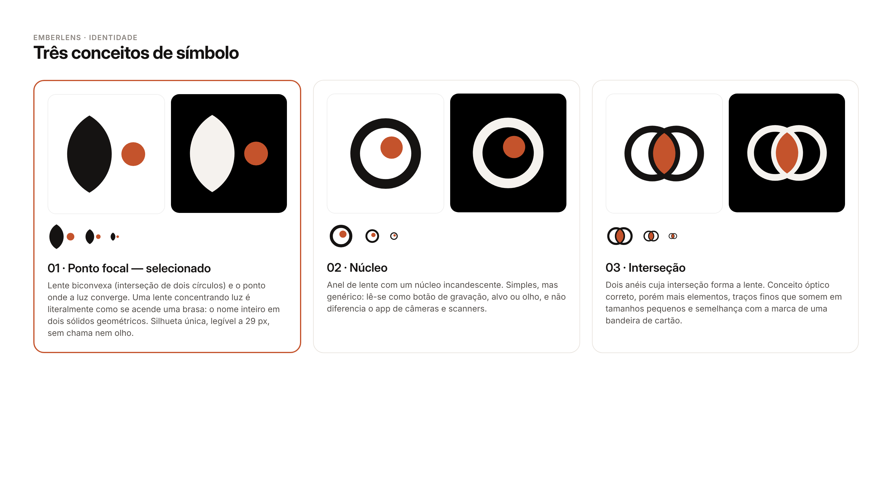
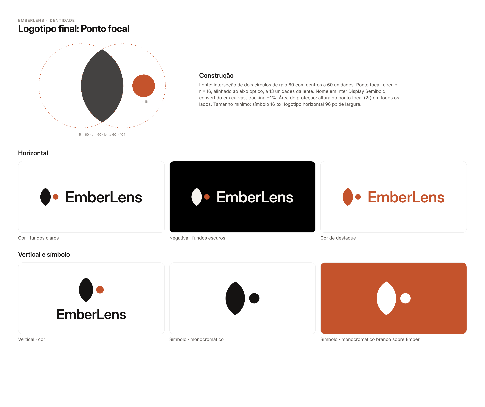

# EmberLens · Guia de marca

## Conceito

**EmberLens = brasa + lente.** O símbolo representa uma **lente biconvexa** (a interseção de dois círculos) e o
**ponto focal**, onde a luz converge. Concentrar luz num ponto é, literalmente, o jeito de acender uma brasa com uma
lente. O nome inteiro cabe em dois sólidos geométricos, sem chama, sem olho, sem cérebro digital e sem nenhum clichê
de IA.

A leitura também combina com o produto: a imagem entra, o modelo converge para uma classificação.

## Conceitos avaliados

| | conceito | decisão |
|---|---|---|
| 01 | **Ponto focal**: lente biconvexa + ponto Ember no eixo óptico | ✅ **Selecionado.** Silhueta única, narrativa direta do nome, 2 elementos, legível a 29 px e reconhecível a 16 px. |
| 02 | **Núcleo**: anel de lente com núcleo incandescente | Genérico. Lê-se como botão de gravação, alvo ou olho. |
| 03 | **Interseção**: dois anéis cuja interseção forma a lente | Mais elementos, traços finos que somem em tamanhos pequenos e semelhança com a marca de uma bandeira de cartão. |

## Construção do símbolo

* **Lente:** interseção de dois círculos de raio 60 com centros a 60 unidades. O resultado mede 60 × 104 e tem as
  pontas superior e inferior agudas.
* **Ponto focal:** círculo de raio 16, centrado no eixo óptico, a 13 unidades da borda direita da lente.
* **Proporção:** o ponto tem cerca de 31% da altura da lente. A versão do gráfico da Home usa um ponto menor (62%
  do tamanho do símbolo), porque lá ele faz parte de um diagrama óptico, não da marca.
* **Logotipo:** nome em **Inter Display Semibold**, tracking −1%, convertido em curvas. Na versão horizontal, o
  símbolo tem 1,62× a altura das maiúsculas, com espaço de 0,62× a altura das maiúsculas entre símbolo e nome.

### Por que uma fonte complementar no logotipo

A interface usa exclusivamente a fonte do sistema (SF Pro). A licença do SF Pro restringe seu uso a interfaces
nas plataformas Apple, e ela não deve ser usada em logotipos. Por isso o nome é desenhado em **Inter Display**
(SIL Open Font License), que tem proporções próximas do SF Pro Display, e foi convertido em curvas. O arquivo não
depende de nenhuma fonte instalada.

## Arquivos (`branding/logo/`)

Todos os SVGs são vetoriais e editáveis. Os grupos têm ids: `#symbol`, `#lens`, `#focal-point` e `#wordmark`.

| variante | uso | símbolo | horizontal | vertical |
|---|---|---|---|---|
| `color` | fundos claros (padrão) | ✓ | ✓ | ✓ |
| `negative` | fundos escuros | ✓ | ✓ | ✓ |
| `mono-black` | impressão 1 cor, fundos claros | ✓ | ✓ | ✓ |
| `mono-white` | 1 cor sobre fotos, Ember ou escuro | ✓ | ✓ | ✓ |
| `accent` | cor de destaque (Ember), usar com moderação | ✓ | ✓ | ✓ |

Nomes: `emberlens-symbol-<variante>.svg`, `emberlens-logo-horizontal-<variante>.svg`,
`emberlens-logo-vertical-<variante>.svg`.

## Regras de uso

* **Área de proteção:** no mínimo o diâmetro do ponto focal (2r) em todos os lados.
* **Tamanho mínimo:** símbolo com 16 px de altura; logotipo horizontal com 96 px de largura.
* O ponto focal fica **sempre** à direita da lente e alinhado ao eixo horizontal.
* **Não** girar, espelhar, distorcer, contornar, adicionar sombra ou brilho, trocar a cor da lente por gradiente,
  aproximar o ponto da lente nem colocar o símbolo dentro de outra forma (exceto no App Icon).
* Sobre fotografias, use `mono-white` com contraste suficiente, ou evite.

## App Icon (`branding/app-icon/`)

| arquivo | aparência | especificação |
|---|---|---|
| `AppIcon.appiconset/AppIcon-Light.png` | padrão / clara | 1024 × 1024, **RGB sem alfa** (exigência da App Store), fundo Paper com gradiente sutil, lente Ink, ponto Ember |
| `AppIcon.appiconset/AppIcon-Dark.png` | escura (iOS 18+) | 1024 × 1024, **fundo transparente** (o sistema aplica o fundo escuro), lente Paper, ponto Ember 300 |
| `AppIcon.appiconset/AppIcon-Tinted.png` | tintada (iOS 18+) | 1024 × 1024, escala de cinza sobre transparente. Lente 74% e ponto 100% de luminância, para que o sistema diferencie os dois ao aplicar a cor |
| `AppIcon.appiconset/Contents.json` | — | formato *single size* com `appearances` (luminosity dark/tinted), compatível com Xcode 16+ |
| `svg/*.svg` | — | fontes vetoriais de cada variante e da prévia do modo escuro |
| `layers/*.svg` | — | fundo, lente e ponto em camadas separadas, para montar a versão Liquid Glass no **Icon Composer** (iOS 26), que não foi gerada aqui |

* O ícone é quadrado e **não simula o arredondamento** do iOS.
* O símbolo ocupa cerca de 56% da largura e fica deslocado 2,2% para a direita, para compensar visualmente a massa
  da lente.
* Não há texto nem elementos de interface no ícone.
* `preview-sizes.png` mostra o ícone com máscara e tamanhos simulados, apenas para revisão. Na linha tintada, a cor
  é uma simulação.

## Cores da marca

| nome | hex | uso |
|---|---|---|
| Ember 600 | `#C4532C` | acento principal: botões, ponto focal, destaque. Refinado a partir da referência `#D96B45` para atingir 4,54:1 com branco |
| Ember 300 | `#EC8157` | acento sobre fundos escuros: texto, tint, barras no Dark Mode |
| Ink | `#151312` | lente no fundo claro, preto quente da marca |
| Paper | `#F5F2EE` | branco quente da marca, fundo do App Icon |

A paleta completa e os tokens de interface estão em [`design-system.md`](design-system.md).
