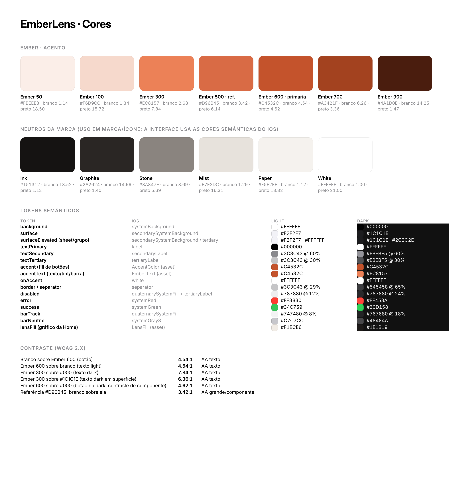
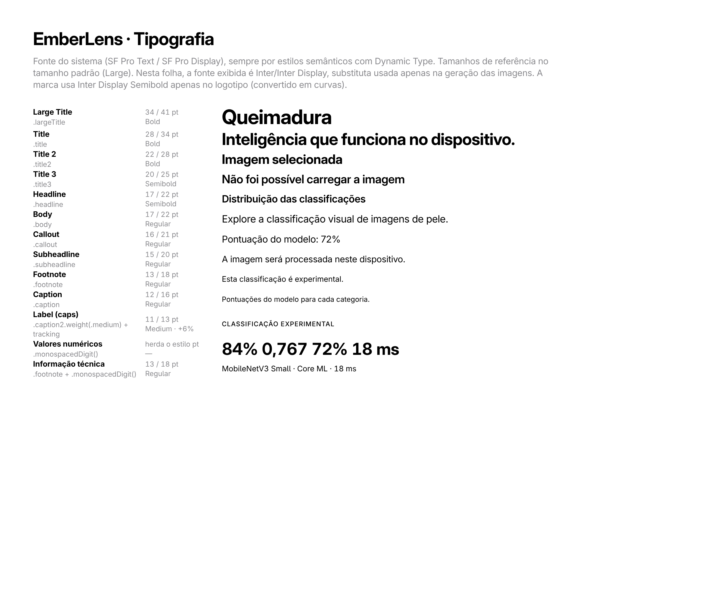
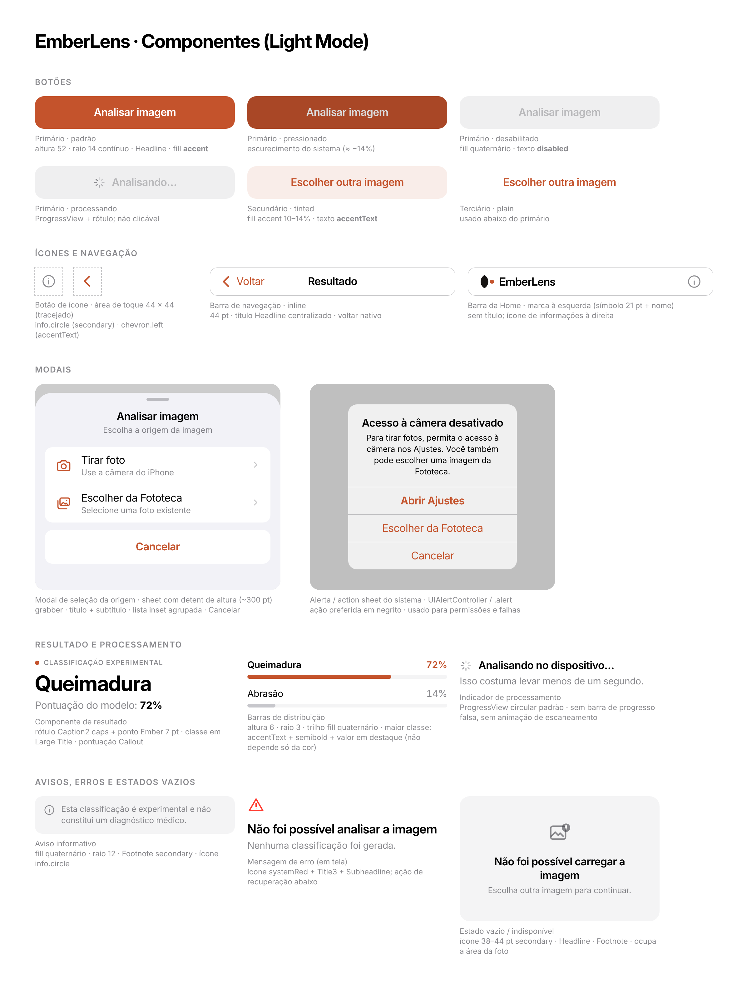

# EmberLens · Design system

Princípio geral: **componentes nativos do iOS e cores semânticas do sistema**, com uma única cor de marca (Ember)
usada com intenção. Composição por tipografia, fotografia e espaço, não por caixas.

## 1. Cores

### Tokens semânticos

| token | SwiftUI / UIKit | light | dark |
|---|---|---|---|
| `background` | `Color(.systemBackground)` | `#FFFFFF` | `#000000` |
| `surface` | `Color(.secondarySystemBackground)` | `#F2F2F7` | `#1C1C1E` |
| `textPrimary` | `.primary` / `Color(.label)` | `#000000` | `#FFFFFF` |
| `textSecondary` | `.secondary` / `Color(.secondaryLabel)` | `#3C3C43` 60% | `#EBEBF5` 60% |
| `textTertiary` | `Color(.tertiaryLabel)` | `#3C3C43` 30% | `#EBEBF5` 30% |
| `accent` | `Color.accentColor` (asset **AccentColor**) | `#C4532C` | `#C4532C` |
| `accentText` | `Color("EmberText")` | `#C4532C` | `#EC8157` |
| `onAccent` | `.white` | `#FFFFFF` | `#FFFFFF` |
| `border` | `Color(.separator)` | `#3C3C43` 29% | `#545458` 65% |
| `disabled` | `Color(.quaternarySystemFill)` + `Color(.tertiaryLabel)` | — | — |
| `error` | `Color(.systemRed)` | `#FF3B30` | `#FF453A` |
| `success` | `Color(.systemGreen)` | `#34C759` | `#30D158` |
| `barTrack` | `Color(.quaternarySystemFill)` | — | — |
| `barNeutral` | `Color(.systemGray3)` | `#C7C7CC` | `#48484A` |
| `lensFill` | `Color("LensFill")` | `#F1ECE6` | `#1E1B19` |

Assets prontos: `branding/colors/EmberLensColors.xcassets` (AccentColor, EmberText, BrandInk, LensFill, RayLine).
Os valores em JSON estão em `branding/colors/tokens.json`.

**Por que duas cores de acento.** `#C4532C` com texto branco atinge 4,54:1 (AA), por isso preenche os botões nos
dois modos. Como texto sobre o fundo escuro, porém, ele cai para 3,7:1. Por isso, no Dark Mode, textos, tint e a
barra em destaque usam Ember 300 (`#EC8157`, 6,4:1 sobre `#1C1C1E`). A referência `#D96B45` com texto branco fica em
3,42:1 e reprova.

**Não** há cores por grau de queimadura nem uma cor diferente por classe. O modelo não faz essa classificação, e a
única distinção visual é "classe de maior pontuação" vs. "demais".

## 2. Tipografia

Fonte do sistema (SF Pro), **sempre por estilos semânticos** e com Dynamic Type. Nenhuma fonte externa na
interface.

| papel | estilo SwiftUI | tamanho de referência (pt) | peso | onde |
|---|---|---|---|---|
| Large Title | `.largeTitle.bold()` | 34/41 | Bold | título da Home, classe no Resultado |
| Title | `.title.bold()` | 28/34 | Bold | título da tela Sobre, números de resultados, erro de inferência |
| Title 2 | `.title2.bold()` | 22/28 | Bold | "Imagem selecionada" |
| Title 3 | `.title3.weight(.semibold)` | 20/25 | Semibold | nome no Sobre, estados vazios |
| Headline | `.headline` | 17/22 | Semibold | botões, títulos de seção, título da navegação |
| Body | `.body` | 17/22 | Regular | descrições |
| Callout | `.callout` | 16/21 | Regular | "Pontuação do modelo" |
| Subheadline | `.subheadline` | 15/20 | Regular | rótulos das barras, linhas chave-valor |
| Footnote | `.footnote` | 13/18 | Regular | aviso, rodapé, informações técnicas |
| Caption | `.caption` | 12/16 | Regular | notas |
| Label | `.caption2.weight(.medium)` + `.textCase(.uppercase)` + `.tracking(0.6)` | 11/13 | Medium | "CLASSIFICAÇÃO EXPERIMENTAL", cabeçalhos de seção |
| Valores numéricos | estilo do contexto + `.monospacedDigit()` | — | — | percentuais, ms, métricas |

Nos mockups, a fonte exibida é **Inter / Inter Display**, substituta usada só para gerar as imagens. No app, use a
fonte do sistema.

## 3. Espaçamento e grade

Escala de 4 pt: **4 · 8 · 12 · 16 · 20 · 24 · 32 · 40**.

| regra | valor |
|---|---|
| margem lateral da tela | 20 pt (o padrão de `List`/Form permanece o do sistema) |
| entre seções | 32–36 pt |
| título → descrição | 8–12 pt |
| foto → bloco de texto | 20–22 pt |
| entre linhas de barras | 14 pt (rótulo → barra: 6 pt) |
| botão primário → botão plain | 6 pt |
| conteúdo → indicador de início | ≥ 34 pt (safe area) + 8 pt |

Alinhamento: tudo **à esquerda** (leitura editorial), exceto títulos da barra de navegação, alertas e o título do
sheet, que seguem o sistema.

## 4. Raios e dimensões

| elemento | raio | dimensão |
|---|---|---|
| fotografia | 16 (`.continuous`) | prévia: altura máx. 440; resultado: 300; sempre *aspect fit* |
| botão primário/secundário | 14 (`.continuous`) | altura 52, largura total |
| aviso / estado vazio | 12–16 | — |
| grupo do sheet | 12 | linhas ≥ 60 pt |
| sheet | do sistema | detent ≈ 300 pt |
| barra de distribuição | 3 | altura 6 |
| área mínima de toque | — | **44 × 44 pt** |

## 5. Componentes

| componente | implementação | regras |
|---|---|---|
| Botão primário | `Button` + estilo próprio (fill `accent`, `.headline`, 52 pt, raio 14) ou `.borderedProminent` + `.controlSize(.large)` | Uma ação primária por tela. Estados: normal, pressionado (escurece), desabilitado (`quaternarySystemFill` + `tertiaryLabel`) e processando (`ProgressView` + "Analisando…") |
| Botão secundário | `.bordered` tintado (fill accent 10–14%) ou `.borderless` (plain) | "Escolher outra imagem" usa o estilo plain abaixo do primário |
| Botão de ícone | `Button { } label: { Image(systemName:) }` na toolbar | 44 × 44; info.circle em `.secondary` na Home |
| Barra de navegação | `NavigationStack` + `.navigationBarTitleDisplayMode(.inline)` | Home sem título, com a marca em `ToolbarItem(.topBarLeading)`; voltar nativo |
| Modal de seleção | `.sheet` + `.presentationDetents([.height(300)])` + `.presentationDragIndicator(.visible)` (iOS 16+). No iOS 15, `confirmationDialog` com as mesmas duas opções, sem ícones | Título, subtítulo, duas linhas de **mesmo peso** (câmera / Fototeca) e Cancelar |
| Action sheet / alerta | `.alert` / `.confirmationDialog` | Permissões e falhas; ação preferida em negrito |
| Indicador de processamento | `ProgressView()` circular | Sem barra de progresso falsa, sem animação de escaneamento, sem atraso artificial |
| Barras de distribuição | `HStack` (rótulo + valor) + `Capsule` proporcional, ou `ProgressView(value:)` estilizado | Ordem fixa (Queimadura, Abrasão, Hematoma, Laceração, Pele normal). A maior classe usa `accentText` **e** semibold, com o valor também destacado: a distinção não depende só da cor |
| Componente de resultado | rótulo caps + ponto Ember 7 pt, classe em Large Title, pontuação em Callout | Texto fixo "Classificação experimental"; nunca "diagnóstico" |
| Aviso informativo | `Label` com info.circle sobre `quaternarySystemFill`, raio 12 | Footnote secondary; visível sem dominar |
| Mensagem de erro | ícone `systemRed` + Title/Title3 + Subheadline + ação de recuperação | Explica o que aconteceu e o que fazer |
| Estado vazio / indisponível | ícone 38–44 pt secondary + Headline + Footnote, na área da foto | `ContentUnavailableView` (iOS 17+) ou equivalente manual para iOS 15–16 |

## 6. Iconografia

* **Interface:** apenas SF Symbols. Nos mockups, os ícones são redesenhos simplificados para representação.

  | uso | SF Symbol |
  |---|---|
  | informações (Home) | `info.circle` |
  | tirar foto | `camera` |
  | escolher da Fototeca | `photo.on.rectangle` |
  | processamento local (rodapé) | `iphone` |
  | erro / alerta | `exclamationmark.triangle` |
  | imagem inválida | `photo.badge.exclamationmark` |
  | tentar novamente | `arrow.clockwise` |
  | link externo | `arrow.up.right` |
  | navegação | `chevron.left` / `chevron.right` (do sistema) |

* **Marca:** somente o símbolo proprietário (nunca um SF Symbol como logotipo).
* Proibido: cérebros, circuitos, "sparkles" de IA, retículas de escaneamento.

## 7. Movimento

* Transições nativas do `NavigationStack` e do sheet. Nenhuma animação customizada é necessária.
* O resultado aparece quando a inferência termina, sem tempo mínimo artificial.
* Feedback tátil discreto: `.sensoryFeedback(.success, trigger:)` (iOS 17+) ao concluir e `.error` em falha.
  Opcional.
* **Reduce Motion:** sem efeitos de escala ou paralaxe. Se alguma transição personalizada for adicionada, ela deve
  virar crossfade.
* O gráfico da Home é **estático**.

## 8. Acessibilidade

* **Dynamic Type** até os tamanhos de acessibilidade. As linhas chave-valor passam a empilhar (`ViewThatFits` ou
  `AnyLayout`) em tamanhos grandes. O título da Home quebra livremente.
* **Contraste:** textos ≥ 4,5:1 (veja a tabela da paleta). Os botões atingem 4,54:1.
* **VoiceOver:**
  * gráfico da Home: `accessibilityHidden(true)`, por ser decorativo;
  * marca na toolbar: label "EmberLens";
  * info: "Sobre o EmberLens";
  * foto: "Imagem selecionada";
  * cada barra: "Queimadura, 72 por cento, maior pontuação" (agrupar com `.accessibilityElement(children: .combine)`);
  * processamento: anunciar "Analisando no dispositivo" e, ao terminar, "Resultado: Queimadura, 72 por cento".
* **Não depender só de cor:** a classe de maior pontuação também usa semibold e o valor destacado. Erros sempre têm
  ícone e texto.
* **Áreas de toque** ≥ 44 × 44 pt.
* **Bold Text** e **Increase Contrast** são respeitados automaticamente pelas cores semânticas e pela fonte do
  sistema.
