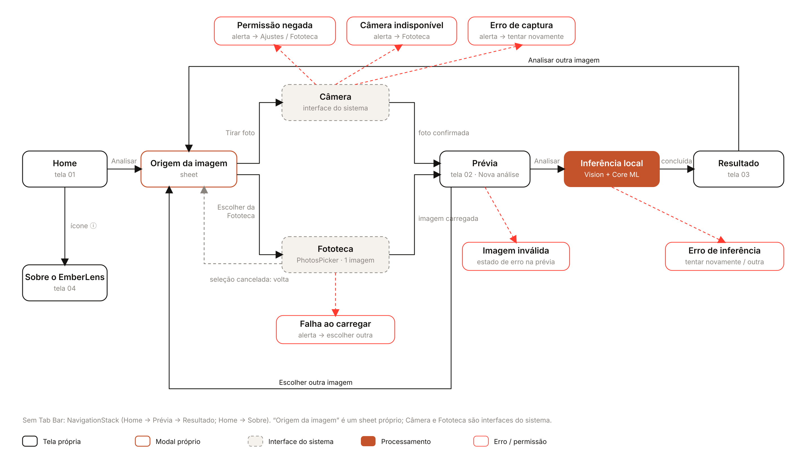

# EmberLens · Especificação para implementação em SwiftUI

Documento de handoff: o que construir, com quais componentes e com quais textos. Os mockups estão em
`../screens/`, em PNG @3x para iPhone 6,1" (393 × 852 pt).

## Premissas

* **Deployment target recomendado: iOS 17.** O modelo Core ML roda desde o iOS 15, mas o iOS 17 dá acesso nativo a
  `PhotosPicker` (16+), `presentationDetents` (16+), `ContentUnavailableView` (17+) e `sensoryFeedback` (17+). Se
  for necessário manter o iOS 15, as alternativas estão indicadas em cada item.
* Com componentes nativos, o app adota automaticamente a aparência do sistema, inclusive o Liquid Glass do iOS 26
  nas barras e nos botões do sistema.
* Nada de login, conta, backend, histórico obrigatório ou recomendações médicas.

## Arquitetura de navegação



```
NavigationStack(path:)
 ├─ HomeView                       (raiz, sem título)
 │    ├─ toolbar(.topBarLeading):  BrandMark
 │    ├─ toolbar(.topBarTrailing): botão info → AboutView (push)
 │    └─ "Analisar imagem" → ImageSourceSheet (.sheet)
 ├─ PreviewView(image)             título "Nova análise"
 ├─ ResultView(image, result)      título "Resultado"
 └─ AboutView                      título "Sobre o EmberLens"
ImageSourceSheet → Câmera (UIImagePickerController .camera, via UIViewControllerRepresentable)
                 → Fototeca (PhotosPicker, selectionBehavior single, matching .images)
```

* Sem Tab Bar.
* Ao concluir a inferência, empurrar `ResultView`.
* "Analisar outra imagem" abre o mesmo `ImageSourceSheet`. Com a nova imagem, o app volta para uma `PreviewView`
  nova, substituindo o caminho por `[.preview(img)]`.

### Contrato de dados

```swift
struct ClassificationResult {
    let scores: [LesionClass: Double]   // softmax, soma 1.0
    let top: LesionClass
    let inferenceTime: Duration         // medido em torno da chamada real do modelo
}
enum LesionClass: CaseIterable { case burn, abrasion, bruise, laceration, normalSkin }
// rótulos do modelo: "Burn", "Abrasion", "Bruise", "Laceration", "Normal Skin"
// rótulos exibidos: Queimadura, Abrasão, Hematoma, Laceração, Pele normal
```

* **Entrada do modelo:** `VNCoreMLRequest` com `imageCropAndScaleOption = .centerCrop`, passando a
  `CGImagePropertyOrientation` da imagem. Detalhes em `docs/coreml-conversion.md`.
* **Tempo de inferência:** medir somente a execução real (por exemplo, `ContinuousClock` em torno de
  `handler.perform`). Nunca exibir um número fixo. Os "18 ms" dos mockups são **ilustrativos**.

---

## Tela 01 · Home

Mockups: `screens/home/home-light.png`, `home-dark.png`

| região | conteúdo | especificação |
|---|---|---|
| toolbar | BrandMark à esquerda; `info.circle` à direita | símbolo 21 pt de altura + "EmberLens" (Headline semibold). Info em `.secondary`, área de 44 pt, label de acessibilidade "Sobre o EmberLens" |
| gráfico | diagrama óptico proprietário: raios paralelos → lente (`LensFill`) → convergem no ponto Ember; eixo pontilhado; "f" | ≈ 300 pt de altura, largura total, **estático**, `accessibilityHidden(true)`. Desenhar com `Canvas`/`Path` ou usar o SVG exportado como asset vetorial |
| título | "Observe além da imagem." | `.largeTitle.bold()`, alinhado à esquerda, margem 20 |
| descrição | "Explore a classificação visual de imagens de pele com inteligência artificial executada diretamente no seu iPhone." | `.body`, `.secondary`, 12 pt abaixo do título |
| ação | **Analisar imagem** | botão primário de largura total, preso à parte inferior |
| rodapé | `iphone` + **Processamento local** / "Suas imagens não são enviadas para servidores." | `.footnote`; título semibold e texto `.secondary` |

> ⚠️ O texto "Suas imagens não são enviadas para servidores." só pode ser exibido se o app **não** fizer nenhuma
> chamada de rede com as imagens: sem analytics de imagem e sem upload. Se isso mudar, remova o texto.

### Modal "Origem da imagem"

Mockups: `screens/image-selection/source-sheet-light.png`, `-dark.png`, `source-sheet-from-preview-*.png`

* `.sheet` com detent ≈ 300 pt e grabber visível.
* Título "Analisar imagem" (ou "Escolher outra imagem" quando aberto pela Prévia), em Headline. Subtítulo "Escolha a
  origem da imagem", em Footnote secondary.
* Grupo inset com duas linhas de **mesmo peso visual**:
  * `camera` · **Tirar foto** · "Use a câmera do iPhone"
  * `photo.on.rectangle` · **Escolher da Fototeca** · "Selecione uma foto existente"
* Grupo separado com **Cancelar** (semibold, `accentText`).
* No iOS 15, use `confirmationDialog("Analisar imagem")` com as ações "Tirar foto", "Escolher da Fototeca" e
  "Cancelar" (sem ícones).

## Fluxo de captura

**Câmera**
* Use `UIImagePickerController(sourceType: .camera)`. A interface nativa já oferece captura e as opções "Usar foto"
  ou "Repetir".
* Antes, verifique `UIImagePickerController.isSourceTypeAvailable(.camera)` e
  `AVCaptureDevice.authorizationStatus(for: .video)`.
* `Info.plist`: `NSCameraUsageDescription` = "O EmberLens usa a câmera para fotografar a imagem que será analisada
  no próprio iPhone."

**Fototeca**
* Use `PhotosPicker(selection:, matching: .images)` com seleção única. O picker roda fora do processo do app e **não
  requer permissão de acesso à biblioteca**. Não solicite `NSPhotoLibraryUsageDescription`.
* Carregue a imagem com `loadTransferable(type: Data.self)`. No iOS 15, use `PHPickerViewController`.
* Câmera e Fototeca levam à mesma `PreviewView`.

**Estados**

| situação | apresentação | mockup |
|---|---|---|
| permissão da câmera negada ou restrita | alerta "Acesso à câmera desativado": **Abrir Ajustes** (`UIApplication.openSettingsURLString`), Escolher da Fototeca, Cancelar | `image-selection/camera-permission-denied-*.png` |
| câmera indisponível | alerta "Câmera indisponível": **Escolher da Fototeca**, OK | `camera-unavailable-*.png` |
| erro ao capturar | alerta "Não foi possível capturar a foto": **Tentar novamente**, Cancelar | `camera-capture-error-*.png` |
| captura ou seleção cancelada | fecha o fluxo e volta à tela anterior, sem mensagem | — |
| falha ao carregar da Fototeca | alerta "Não foi possível carregar a imagem": **Escolher outra imagem**, OK | `library-load-failed-*.png` |

## Tela 02 · Prévia

Mockups: `screens/preview/preview-ready-*.png`, `preview-processing-*.png`, `preview-load-error-*.png`

* Navegação inline "Nova análise" com o voltar nativo.
* "Imagem selecionada" em `.title2.bold()`.
* **Foto:** `Image(uiImage:).resizable().scaledToFit()`, em quadro de largura total com altura máxima de 440 pt,
  fundo `quaternarySystemFill` e raio 16. A proporção original é **preservada, sem corte**. Fotos em retrato
  preenchem a altura; fotos em paisagem preenchem a largura.
* Status: **Pronto para analisar** (Headline) e "A imagem será processada diretamente neste dispositivo."
  (Subheadline secondary).
* Ações presas embaixo: **Analisar imagem** (primário) e **Escolher outra imagem** (plain), que reabre o sheet.

**Processando** (ao tocar em Analisar):
* O primário fica desabilitado e o secundário também é desabilitado.
* O status troca para `ProgressView()` + **Analisando no dispositivo…** e "Isso costuma levar menos de um segundo."
* A foto continua visível.
* **Proibido:** atraso artificial, animação de escaneamento, bounding boxes, máscaras ou contornos. O modelo é um
  classificador e não localiza a lesão.
* Ao terminar, faça o push de `ResultView`.

**Imagem inválida / erro ao carregar:** o quadro da foto vira o estado vazio (`photo.badge.exclamationmark`,
**"Não foi possível carregar a imagem"**, "O arquivo pode estar corrompido ou em um formato incompatível.") e a ação
única é **Escolher outra imagem**.

## Tela 03 · Resultado

Mockups: `screens/result/result-full-*.png` (rolagem inteira), `result-viewport-*.png`,
`result-inference-error-*.png`

Tudo fica dentro de um `ScrollView`, com margem de 20 pt:

1. **Foto**: aspect fit, altura máxima de 300 pt, raio 16.
2. **Rótulo**: ponto Ember de 7 pt + "CLASSIFICAÇÃO EXPERIMENTAL" (Label caps, secondary).
3. **Classe**: nome da classe de maior pontuação em `.largeTitle.bold()`.
4. "Pontuação do modelo: **72%**" em `.callout`, secondary, com o valor em `.primary` semibold e
   `.monospacedDigit()`.
5. Divisória.
6. **Distribuição das classificações** (Headline), com 5 linhas em **ordem fixa**: Queimadura, Abrasão, Hematoma,
   Laceração, Pele normal.
   * Cada linha tem rótulo (Subheadline) e valor (Subheadline, `.monospacedDigit()`), e logo abaixo uma barra de
     6 pt sobre trilho `quaternarySystemFill`.
   * Maior classe: barra `EmberText`, rótulo e valor semibold, valor em `EmberText`.
   * Demais classes: barra `systemGray3` e valor `.secondary`.
   * Percentual = `round(score * 100)`. Valores abaixo de 1% aparecem como "<1%".
   * Nota em Footnote tertiary: "Pontuações do modelo para cada categoria (softmax). Somam 100%."
7. **Informações técnicas**: cabeçalho caps e linhas chave-valor em Footnote, com divisórias finas:
   Modelo — MobileNetV3 Small; Framework — Core ML; Execução — Processamento local; Tempo de inferência — *medido*
   ms.
8. **Aviso**: `info.circle` + "Esta classificação é experimental e não constitui um diagnóstico médico." (Footnote
   secondary sobre `quaternarySystemFill`, raio 12).
9. **Analisar outra imagem**: botão primário que abre o sheet de origem.

Textos proibidos: "diagnóstico confirmado", "identificada com segurança", "precisão médica", "tratamento
recomendado", ou qualquer recomendação clínica.

**Erro de inferência:** a foto aparece com 55% de opacidade, seguida de `exclamationmark.triangle` (systemRed),
**"Não foi possível analisar a imagem"** (`.title.bold()`) e "Ocorreu um erro durante o processamento no dispositivo.
Nenhuma classificação foi gerada." O código técnico aparece em Footnote tertiary. As ações são **Tentar novamente**
(primário, `arrow.clockwise`) e **Escolher outra imagem** (plain).

Para imagem incompatível, use o mesmo layout com a mensagem "Esta imagem não pôde ser preparada para análise. Escolha
outra imagem." e uma única ação, **Escolher outra imagem**, como botão primário.

## Tela 04 · Sobre o EmberLens

Mockups: `screens/about/about-full-*.png`, `about-viewport-*.png`

Layout editorial em `ScrollView`, sem cartões, com seções separadas por cabeçalhos caps e divisórias finas:

1. Símbolo de 46 pt + **EmberLens** (Title3) + "Classificação experimental de imagens de pele" (Footnote secondary).
2. **"Inteligência que funciona no dispositivo."** (`.title.bold()`) seguido do parágrafo de descrição (Body
   secondary).
3. **MODELO DE INTELIGÊNCIA ARTIFICIAL**, em linhas chave-valor (Subheadline): Arquitetura MobileNetV3 Small ·
   Treinamento PyTorch · Inferência Core ML · Entrada 224 × 224 pixels · Categorias 5 · Execução No dispositivo.
4. **RESULTADOS EXPERIMENTAIS**: três números em `.title.bold()` com `.monospacedDigit()`: **84%** Accuracy ·
   **0,767** Macro F1 · **68%** Recall de queimaduras. Abaixo, a ressalva: "Obtidos em um conjunto de teste limitado
   (187 imagens). Não representam desempenho clínico validado."
5. **LIMITAÇÕES**: quatro itens marcados com travessão (dataset público da web; sem validação clínica suficiente;
   generalização para fotos reais de iPhone não medida; não são diagnósticos).
6. **INSPIRAÇÃO**: parágrafo sobre a pesquisa Pelis (Unifor) e a referência em Footnote:
   AGUIAR, G. A. F. et al. *Inteligência artificial para classificação e auxílio na terapia tópica de queimaduras em
   tempo real.* Enfermagem em Foco, v. 10, n. 5, 2019.
7. Linha **Código-fonte no GitHub** → "emberlens ↗" (`Link`), seguida de **Versão** `1.0 (1)` (leitura de
   `CFBundleShortVersionString`/`CFBundleVersion`) e dos créditos (dataset CC BY 4.0 e pesos iniciais ImageNet).

> A entrada do modelo é de 224 × 224 na rede. O pacote Core ML recebe 256 × 256 e recorta 224 internamente. A tela
> mostra o tamanho efetivo da rede.

---

## Textos (pt-BR)

| chave | texto |
|---|---|
| home.title | Observe além da imagem. |
| home.body | Explore a classificação visual de imagens de pele com inteligência artificial executada diretamente no seu iPhone. |
| action.analyze | Analisar imagem |
| home.local.title | Processamento local |
| home.local.body | Suas imagens não são enviadas para servidores. |
| source.title | Analisar imagem |
| source.subtitle | Escolha a origem da imagem |
| source.camera / .cameraHint | Tirar foto / Use a câmera do iPhone |
| source.library / .libraryHint | Escolher da Fototeca / Selecione uma foto existente |
| action.cancel | Cancelar |
| preview.navTitle | Nova análise |
| preview.title | Imagem selecionada |
| preview.ready / .readyBody | Pronto para analisar / A imagem será processada diretamente neste dispositivo. |
| preview.processing / .processingBody | Analisando no dispositivo… / Isso costuma levar menos de um segundo. |
| action.chooseAnother | Escolher outra imagem |
| result.navTitle | Resultado |
| result.label | Classificação experimental |
| result.score | Pontuação do modelo: %@ |
| result.distribution | Distribuição das classificações |
| result.tech | Informações técnicas |
| result.disclaimer | Esta classificação é experimental e não constitui um diagnóstico médico. |
| action.analyzeAnother | Analisar outra imagem |
| error.inference.title / .body | Não foi possível analisar a imagem / Ocorreu um erro durante o processamento no dispositivo. Nenhuma classificação foi gerada. |
| action.retry | Tentar novamente |
| about.navTitle | Sobre o EmberLens |
| about.title | Inteligência que funciona no dispositivo. |
| class.* | Queimadura · Abrasão · Hematoma · Laceração · Pele normal |

## Assets para o projeto Xcode

| asset | origem |
|---|---|
| App Icon | `branding/app-icon/AppIcon.appiconset/` (arrastar para Assets.xcassets) |
| Cores | `branding/colors/EmberLensColors.xcassets/` (AccentColor, EmberText, BrandInk, LensFill, RayLine) |
| Símbolo da marca | `branding/logo/emberlens-symbol-color.svg` (SVG em asset catalog, "Preserve Vector Data"; para a toolbar, usar BrandInk + AccentColor) |
| Gráfico da Home | recriar com `Canvas`/`Path` usando a geometria do símbolo (veja `source/screens.py`, função `hero`), ou exportar como SVG |

## O que é ilustrativo nos mockups

* **Fotografia:** textura de pele gerada por código, sem lesão e sem uso de fotos médicas. Substitua pela imagem real
  do usuário.
* **Pontuações** (72/14/3/9/2%) e **tempo de inferência** (18 ms): exemplos visuais.
* **Fonte:** Inter / Inter Display no lugar do SF Pro.
* **Ícones:** redesenhos que representam os SF Symbols listados.
* **Barra de status, Dynamic Island e alertas:** representações do sistema.
