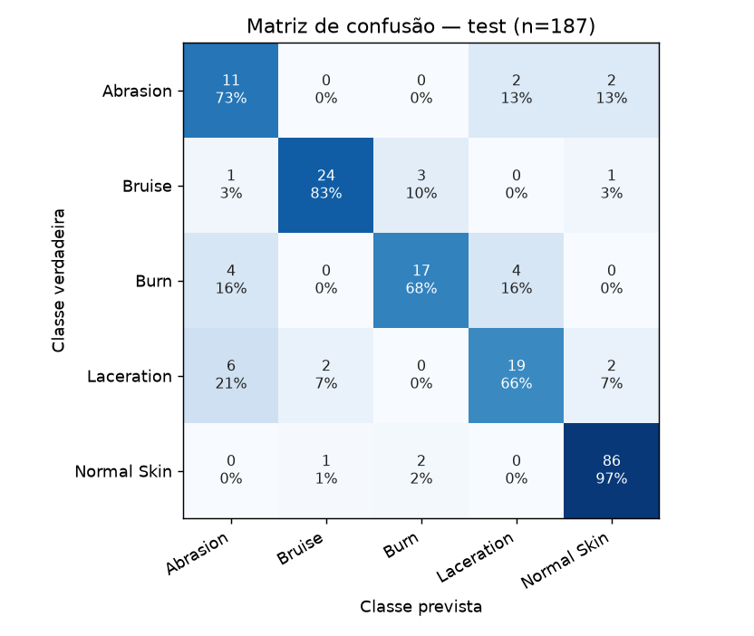
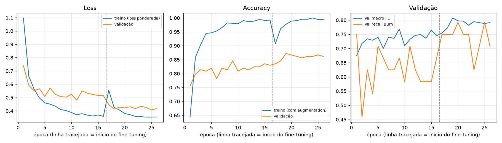

# Avaliação do modelo

Modelo avaliado: `ml/models/best_model.pt` (execução `finetune_last4`, PyTorch, FP32). Os números abaixo vêm de
`ml/reports/{val,test}/metrics.json` e `classification_report.txt`.

## Resumo

| métrica | validação (n = 188) | teste (n = 187) | IC 95% teste (bootstrap) |
|---|---|---|---|
| accuracy | 0,872 | **0,840** | 0,786 – 0,893 |
| macro F1 | 0,808 | **0,767** | 0,690 – 0,835 |
| recall Burn | 0,750 (18/24) | **0,680 (17/25)** | 0,483 – 0,857 |
| precision Burn | 0,818 | 0,773 | — |

O conjunto de teste foi usado uma única vez, depois de todas as decisões tomadas com a validação.

## Teste: métricas por classe

| classe | precision | recall | F1 | suporte |
|---|---|---|---|---|
| Abrasion | 0,500 | 0,733 | 0,595 | 15 |
| Bruise | 0,889 | 0,828 | 0,857 | 29 |
| Burn | 0,773 | 0,680 | 0,723 | 25 |
| Laceration | 0,760 | 0,655 | 0,704 | 29 |
| Normal Skin | 0,945 | 0,966 | 0,956 | 89 |

## Matriz de confusão (teste)

| verdadeira \ prevista | Abrasion | Bruise | Burn | Laceration | Normal Skin |
|---|---|---|---|---|---|
| Abrasion | **11** | 0 | 0 | 2 | 2 |
| Bruise | 1 | **24** | 3 | 0 | 1 |
| Burn | 4 | 0 | **17** | 4 | 0 |
| Laceration | 6 | 2 | 0 | **19** | 2 |
| Normal Skin | 0 | 1 | 2 | 0 | **86** |

## Curvas de treinamento

A linha tracejada marca o início do fine-tuning parcial. Com o backbone congelado, o treino satura perto de 99% de
accuracy enquanto a validação estabiliza. O fine-tuning dos últimos 4 blocos reduz a loss de validação.

## Erros e interpretabilidade (Grad-CAM)

As galerias com Grad-CAM (`ml/reports/{val,test}/gallery.html`) são geradas localmente por `src/report.py` e não são
versionadas, porque contêm imagens do dataset.

* **Queimaduras graves** (rosto, perna, mão com tecido exposto) são classificadas como Abrasion ou Laceration, às
  vezes com confiança acima de 90%. Das 25 queimaduras do teste, 8 foram perdidas: 4 viraram Abrasion e 4 viraram
  Laceration. O treino de Burn é dominado por vermelhidão e queimadura solar.
* **Abrasion ↔ Laceration** é a maior confusão (6 lacerações previstas como Abrasion). A fronteira entre as classes é
  ambígua no próprio dataset, que rotula a mesma foto das duas formas. Um caso residual permanece no teste.
* **Bruise → Burn** (3 casos): hematomas avermelhados ou arroxeados.
* **Atalhos visuais revelados pelo Grad-CAM:**
  * em capturas de tela de vídeo de Burn, a ativação se concentra na barra preta ou na interface do player, não na
    pele;
  * uma foto de pele normal com sombra de planta foi classificada como Burn;
  * uma abrasão no supercílio foi classificada como Normal Skin, com ativação no olho e na marca d'água "iStock".
* Na maioria dos acertos, a ativação fica sobre a lesão. Isso indica que o modelo usa a região certa, mas não que
  use critérios clinicamente relevantes.

## Limitações

* **Amostra pequena.** São 25 queimaduras distintas no teste, e o intervalo de 95% do recall de Burn vai de 0,48 a
  0,86. Diferenças de poucos pontos entre configurações estão dentro do ruído.
* **A accuracy é inflada por Normal Skin.** Essa classe é 48% do teste e é composta quase só de close-ups de textura,
  com enquadramento diferente das fotos de lesão. O macro F1 e o recall por classe são as métricas relevantes.
* **Pouca diversidade real.** O treino tem 94 fotos distintas de Burn e 48 de Abrasion.
* **Domínio.** As imagens vêm da web (stock, marcas d'água, capturas de vídeo), com distribuição desbalanceada de tons
  de pele e regiões do corpo. O desempenho em fotos de câmera de iPhone em condições reais **não foi medido** e deve
  ser considerado desconhecido.
* **Rótulos.** Não há verificação clínica nem grau de queimadura, e existem ambiguidades entre Abrasion e Laceration.
* **Sem validação clínica.** O EmberLens não é um dispositivo médico e suas saídas não são diagnósticos.

## Equivalência após a conversão

A verificação do modelo Core ML está em [`coreml-conversion.md`](coreml-conversion.md). As métricas acima são do
modelo PyTorch FP32. A equivalência numérica do `EmberLens.mlpackage` (FP16) com o runtime do Core ML ainda precisa
ser medida no macOS.
